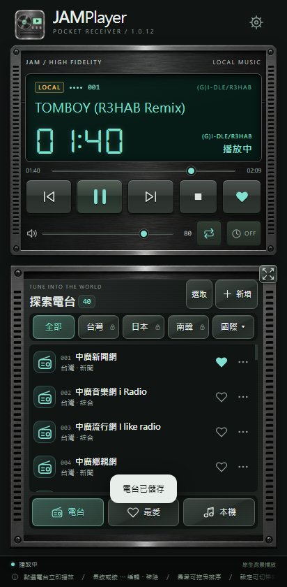
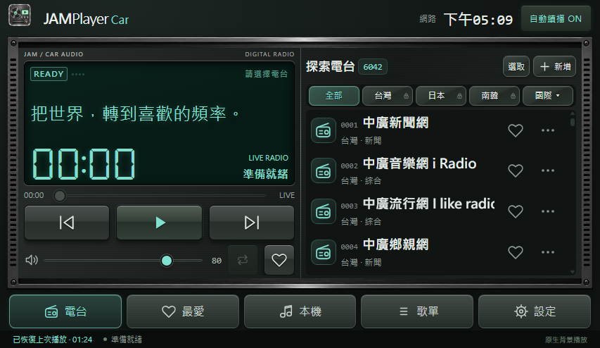

# JAMPlayer

<p align="center"></p>

**全球網路電台與本機音樂，一個 APP 就夠。**

復古金屬拉絲面板、七段 LED 時間顯示，提供 Android 手機／平板與獨立車機版。

## 下載安裝

請到 [Releases 發行頁](https://github.com/liangj823/JAMPlayer/releases/latest) 下載正式簽署的 APK。兩個版本可分別安裝，既有使用者直接覆蓋更新即可保留原資料。

| 版本 | 最新版本 | 適用裝置 |
|---|---|---|
| JAMPlayer | 1.0.13 | Android 8.0 以上手機、平板 |
| JAMPlayer Car | 1.0.4 | Android 12 以上車機 |

## 功能特色

- **全球電台**：目前使用中的清單約 6,284 台（持續更新，筆數會變動）；依國家／地區瀏覽，支援手動新增與五個 GitHub 公開來源的自動／手動更新。
- **本機音樂**：掃描歌曲，接收其他 APP 分享或開啟的音樂檔；略過隱藏目錄與可辨識的電話錄音。
- **最愛與自訂歌單**：電台、音樂分開收藏；單選／多選加入歌單，支援排序、改名與批量管理。
- **播放模式**：清單循環、單曲循環與隨機播放；依各自清單播放，切曲後捲動定位並高亮。
- **國家內切台**：從指定國家開始播放後，上下首只在該國清單切換；瀏覽其他分類不會改變原播放範圍。
- **個人化**：三種主題、12 種語言、橫直式自適應，以及本機備份／還原。
- **背景播放**：通知欄媒體控制、睡眠定時；手機版另有背景一小時自動關閉開關。
- **免註冊**：不需要 JAMPlayer 帳號；設定與收藏保存在裝置內。

電台清單筆數不代表所有來源隨時可連線；音質與播放地區限制由廣播來源決定。本機音樂檔不包含在本專案中。

## 手機／平板版



支援手機與平板、橫直式排列、直式清單放大與設定全頁顯示。圖片用於展示介面風格，部分預覽上的版本文字可能較舊。

## 車機版



- 固定橫式，左右 5:5、共用一個金屬外框，中央細分隔線。
- 電台、最愛、本機、歌單、設定五個大型主功能按鈕。
- 清單字體大小 14–28 px；LED 數字依可用寬度縮放。
- 關閉螢幕後繼續播放；亮屏不重播。
- 車機系統啟動 APP 後，可恢復上次電台或歌曲秒數；預設等待 3 秒，支援關閉或調整等待時間。
- 支援 Android 標準媒體按鍵；方向盤按鍵需由車機系統正確映射。

APP 自啟動由車機系統設定。真正斷電或系統深度休眠造成服務停止時，於重新開啟 APP 後依設定續播。

## 原始碼目錄

- `Android/Source`：手機／平板版。
- `Android-Car/Source`：車機版。
- `docs/images`：圖示與介面預覽。
- `THIRD_PARTY_NOTICES.md`：電台資料、字體與依賴來源。

## 開發與建置

需要 JDK 17 以上、Android SDK（compileSdk 37）及可使用的 Android Studio／Gradle 環境。

Windows PowerShell，在對應版本的 `Source` 目錄執行：

```powershell
./Build.ps1
```

預設產生 debug APK，位於 `app/build/outputs/apk/debug/`。建置腳本會先將 `ui/` 同步到 Android assets。

資料處理測試（需要 Node.js）：

```powershell
node --test test/*.test.cjs
```

正式簽署使用 `./Build.ps1 -Release`。請在本機設定 `JAMPLAYER_KEYSTORE_PATH`、`JAMPLAYER_KEY_ALIAS`（預設 amplayer）、`AMPLAYER_STORE_PASSWORD` 與 `AMPLAYER_KEY_PASSWORD`。正式簽署金鑰、憑證密碼與個人設定不包含於儲存庫。

自行建置的 debug APK 使用不同簽章，無法直接覆蓋官方簽署 APK；如需保留既有資料，請先使用 APP 的備份功能。

## 第三方資料與版權

請參閱 [THIRD_PARTY_NOTICES.md](THIRD_PARTY_NOTICES.md) 及各上游授權。公開原始碼不代表另行授予本專案原創程式碼與美術素材的開源授權；目前未指定額外的開源授權條款。

Developed by Jay.W · Copyright © 2026. All rights reserved.
